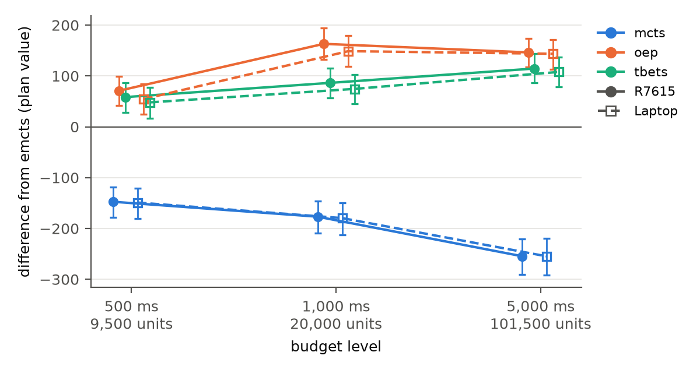

# MAGAT — Multi-Action Game Algorithm Tester

MAGAT evaluates search algorithms for **multi-action games**, where a turn is a sequence of actions,
by replanning single turns on a pinned portfolio of positions under a **compute-unit budget**. A unit
is a priced count of operations, so a budget buys the same work on any machine.

**The takeaway: compute-based budgeting lets researchers on different machines compare results.** A
result measured on one machine can be replayed exactly on another, re-priced in that machine's
currency, and set beside results measured anywhere. The first game is
[Tribes](https://github.com/GAIGResearch/Tribes).

## The result so far

The same experiment, on a 64-core server (the R7615, the reference machine) and on a laptop, each in a
currency calibrated on that machine:
- both rank the algorithms the same at every level: `oep` > `tbets` > `emcts` > `mcts` > `random`;
- every difference between the two machines lies inside the other's 95% interval;
- the two agree position by position: each algorithm's advantage over `emcts` correlates 0.955–0.995
  across positions between the machines
  ([`docs/results/cross-machine.md`](docs/results/cross-machine.md)).



Every table and figure of the paper is rebuilt from the published runs by one command
([`paper/`](paper/README.md)).

## How it works

- **One turn, replanned.** A portfolio of 400 Tribes positions is captured once and pinned by its
  identity. Every algorithm (an **arm**) replans the turn of the player to move from each position,
  several times, with the same seeds and the same chance events as every other arm, so arms are
  compared pair by pair. The measure is the value of the plan, as the game's heuristic scores it.
- **A budget in compute units.** The meter counts every forward-model call (`advance`, `copy`,
  `evaluate`) and every operation an algorithm declares of its own. A machine's **currency** prices each
  operation in that machine's time. A turn spends units until its budget is gone, so the work a budget
  buys is a count: the same on every machine.
- **Levels are thinking time on a reference machine.** Tribes' levels are 9,500, 20,000 and 101,500
  units: 500, 1000 and 5000 ms of a whole turn, single-threaded, on a Dell PowerEdge R7615
  ([`games/tribes/levels.md`](games/tribes/levels.md)). A result at a level reads as though every arm
  had thought that long on the R7615, whichever machine computed it.
- **Results you can read across papers.** The paired difference against a baseline comes with
  scenario-clustered intervals, and the effect is also given as a **budget multiplier**: how much more
  budget the baseline would need to match the arm. Multipliers are dimensionless, so they compare
  across machines and currencies.

[`docs/DESIGN.md`](docs/DESIGN.md) is the whole design on one page.

## Install

You need JDK 11 or newer (CI tests 11, 17 and 21), Python 3 (CI tests 3.12) with the packages in
[`requirements.txt`](requirements.txt), and git.

```bash
git clone --recurse-submodules https://github.com/mlhcorapi/Multi-Action-Game-Algorithm-Tester.git
```

```bash
cd Multi-Action-Game-Algorithm-Tester
```

```bash
python -m pip install -r requirements.txt
```

```bash
python magat.py build --tests
```

```bash
python magat.py test
```

`python magat.py` with no arguments lists every command. Every command works the same in bash and in
PowerShell. Output goes outside the clone, under `$HOME/magat_runs` (`MAGAT_DATA` moves it).

## A first experiment, in a minute

[`experiments/tribes/examples/oep-vs-tbets.json`](experiments/tribes/examples/oep-vs-tbets.json)
compares `oep` and `tbets` with `emcts` at 500 and 1000 ms, on 40 positions, in the reference machine's
published currency. Read it back, with the run's size and estimated time, then run it:

```bash
python magat.py experiment validate experiments/tribes/examples/oep-vs-tbets.json
```

```bash
python magat.py experiment run experiments/tribes/examples/oep-vs-tbets.json
```

`experiment run` validates the spec, runs it, analyses it, prints the headline and bundles the run and
its report. In the published currency, a turn is the same on every machine, so it takes the R7615's
published turns instead of playing them again, after re-playing a sample of them here field for field
([reusing the published run](docs/EXPERIMENTS.md#reusing-the-published-run)). On the development
laptop it finishes in under ten seconds. The report is
`$HOME/magat_runs/tribes/results/oep-vs-tbets/SUMMARY.md`.

## Your own experiment

An experiment is one JSON file: the algorithms, the levels, the repetitions, the positions and the
currency ([`docs/EXPERIMENTS.md`](docs/EXPERIMENTS.md)):

```json
{
  "name": "my-experiment",
  "game": "tribes",
  "arms": ["emcts", "mcts", "oep"],
  "baseline": "emcts",
  "levels": ["500ms", "5000ms"],
  "repetitions": 4,
  "split": "dev",
  "sources": ["dual"]
}
```

Explore on the development half, `dev`, and confirm once on the holdout half
([methods](docs/METHODS.md#3-two-halves-explore-on-one-confirm-on-the-other)). Running the same command
again resumes a run that stopped.

## Your own machine

A currency of your own makes a budget a share of your machine's time. One session prices every arm,
with a preflight, a stability check, a monitor and a verdict. It needs mains power and nothing else
running, and says when it will finish once the stability check has settled
([`docs/CALIBRATING_A_MACHINE.md`](docs/CALIBRATING_A_MACHINE.md)):

```bash
python magat.py calibrate-controlled --name <your-machine> --preflight
```

```bash
python magat.py calibrate-controlled --name <your-machine>
```

The options can live in a file instead: copy `calibrations/tribes/examples/laptop.json`, give it your
machine's name, and pass `--config <file>` in place of `--name <your-machine>`. Then run the reference
experiment in it, `--weights <your-machine>` finding the currency by its name:

```bash
python magat.py experiment run experiments/tribes/reference.json --weights <your-machine>
```

On a server, [`notebooks/run_magat.ipynb`](notebooks/run_magat.ipynb) runs everything, one cell per
stage, each stage ending in a bundle to download. Its first cell names the files it runs: a calibration
config, or a published currency to spend instead, and the experiment specs.

## Your own algorithm

Write it against the `Game` contract, declare its operations, register it, price it, and compare it
with the four ([`docs/ADDING_AN_ALGORITHM.md`](docs/ADDING_AN_ALGORITHM.md)). Priced into a copy of the
published currency, it is the only algorithm your experiment plays: the reference arms' turns are taken
from the published run.

These steps take a new algorithm from code to a report in a few minutes, on a toy portfolio. At toy size
the numbers mean nothing; the path is the point. The full-size path is the same commands without the toy
flags.

1. **Build a toy portfolio and verify it against the published one** (`VERIFY: PASS` means your machine
   captured the same positions, row for row):

   ```bash
   python magat.py portfolio build --game tribes --out $HOME/magat_runs/portfolio/tribes-toy --targets single=2,dual=1 --threads 2
   ```

   ```bash
   python magat.py portfolio freeze --portfolio $HOME/magat_runs/portfolio/tribes-toy
   ```

   ```bash
   python magat.py portfolio verify --game tribes --portfolio $HOME/magat_runs/portfolio/tribes-toy --published games/tribes/portfolio/v1 --subset --plan 3
   ```

2. **Register an algorithm.** `core/src/magat/agents/first/FirstAgent.java` is a complete example, random
   restarts. Add one line to `TribesAgents.registry()` in
   `games/tribes/src/magat/games/tribes/TribesAgents.java`, then list the arms and audit it:

   ```java
   r.register(magat.agents.first.FirstAgent.factory());
   ```

   ```bash
   python magat.py arms --game tribes
   ```

   ```bash
   python magat.py check audit --game tribes --arms first --budget 4000 --turns 2 --reps 1 --warmup 1
   ```

3. **Price it**, beside the baseline, in a toy currency:

   ```bash
   python magat.py calibrate --game tribes --portfolio $HOME/magat_runs/portfolio/tribes-toy --out $HOME/magat_runs/calibration/tribes-toy --arms emcts,first --levels 2000,4000 --turns 2 --reps 2 --warmup 1 --toy
   ```

4. **Run it against the baseline.** Save this spec as `first-toy.json`:

   ```json
   {
     "name": "first-toy",
     "game": "tribes",
     "arms": ["emcts", "first"],
     "baseline": "emcts",
     "levels": [2000, 4000],
     "repetitions": 1,
     "split": "dev"
   }
   ```

   Then validate, run and analyse it in one command, in the toy currency of step 3, found by its name:

   ```bash
   python magat.py experiment run first-toy.json --portfolio $HOME/magat_runs/portfolio/tribes-toy --weights toy --threads 2 --toy
   ```

5. **Read the report**, `$HOME/magat_runs/tribes/results/first-toy/SUMMARY.md`. It gives the provenance,
   the paired difference against the baseline in units and in seconds, the budget multiplier, the design
   and the scope notes.

## Comparing with published results

Every published row carries its raw operation counts, so:
- **replay**: `check replay` re-plans the published turns on your machine and compares them field for
  field;
- **side by side**: `analyze --run <your run> --compare <the published run>` gives, per arm and level,
  each machine's mean and their difference, both budget multipliers, and how the two agree turn by
  turn and position by position;
- **re-pricing**: `analyze --reprice <currency>` prices every turn of a run in another machine's currency
  and re-scores every arm there;
- **the drift check**: `calibrate-controlled` checks your machine against the published currency, cell
  by cell, and says how far apart the two machines' prices are.

Published so far, for Tribes:
- the portfolio of 400 positions and the levels;
- four reference algorithms, `mcts`, `emcts`, `oep` and `tbets`, and `random`, the floor. `emcts` and
  `tbets` are ports of the engine's own agents, gated field for field against them
  ([`docs/ALGORITHMS.md`](docs/ALGORITHMS.md));
- the reference machine's currency and the reference experiment's run on it
  (`games/tribes/calibration/r7615-time/`, `games/tribes/results/reference/r7615/`);
- the same for the laptop (`.../laptop-i9-14900hx-time/`, `.../laptop-i9-14900hx/`), and the
  comparison of the two (`games/tribes/results/reference/r7615-vs-laptop-i9-14900hx/`).

To check everything works on your machine, the shakedown runs every moving part at toy size in about
ten minutes and exits non-zero on any failure:

```bash
python magat.py shakedown
```

## Documentation

[`docs/README.md`](docs/README.md) indexes every document. Start with:

| Read | For |
|---|---|
| [`docs/EXPERIMENTS.md`](docs/EXPERIMENTS.md) | configuring and running an experiment |
| [`docs/CALIBRATING_A_MACHINE.md`](docs/CALIBRATING_A_MACHINE.md) | measuring your machine's currency |
| [`docs/ADDING_AN_ALGORITHM.md`](docs/ADDING_AN_ALGORITHM.md) | writing, pricing and comparing an algorithm |
| [`docs/DESIGN.md`](docs/DESIGN.md) | the design on one page |
| [`docs/results/cross-machine.md`](docs/results/cross-machine.md) | the reference experiment on two machines |

## Layout

| Path | What |
|---|---|
| `core/` | the Java core (package root `magat`): the meter, the game contract, the agents, portfolio, calibration, the runner, probes, the CLI |
| `games/tribes/` | the Tribes adapter, its published portfolio, levels, currencies and reference runs |
| `games/tribes/engine` | the Tribes engine: a git submodule of a fork of GAIGResearch/Tribes |
| `analysis/` | the Python analysis package, `magat_analysis`, and its tests |
| `experiments/` | experiment specs: the reference experiment, the shakedown, and `examples/` |
| `calibrations/` | calibration configs for `calibrate-controlled --config`: `examples/` for a laptop and a shared server |
| `paper/` | the paper's tables and figures, rebuilt from the published runs by `python magat.py paper` |
| `notebooks/` | the run notebook and the maintainers' levels notebook, generated by `tools/make_notebook.py` |
| `tools/` | the shakedown, `calibrate-controlled`, `calibrate-time`, the paper's builder, the notebook generator and self-test, the layering check, the engine patches |
| `docs/` | the documentation |

## Citing

If you use MAGAT, please cite it: [`CITATION.cff`](CITATION.cff) has the details, and GitHub's "Cite
this repository" button formats them.

## Credits

Tribes is by Diego Perez-Liebana, Yu-Jhen Hsu, Stavros Emmanouilidis, Bobby Khaleque and Raluca
Gaina: *Tribes: A New Turn-Based Strategy Game for AI Research*, AAAI Conference on Artificial
Intelligence and Interactive Digital Entertainment (AIIDE), 2020. The engine MAGAT runs is a fork of
their repository, with the agents MAGAT's ports are checked against and MAGAT's own changes: data files
found from any directory, and faster legal-action generation with identical results
([`tools/engine/README.md`](tools/engine/README.md)). The upstream repository carries no licence file;
the authors have given permission for MAGAT's use of their code. The fork is used as a submodule with
attribution, and none of it is copied into this repository.

The reference algorithms come from Kocsis and Szepesvári (2006) and Browne et al. (2012) for MCTS,
Baier and Cowling (2018) for EMCTS, Justesen et al. (2017) for OEP, and Taylor Neller for TBETS
([the paper](https://doi.org/10.1007/978-3-032-23657-9_12),
[the code](https://github.com/TaylorNeller/TUBSTAP_Taylor)). Their references are in
[`docs/ALGORITHMS.md`](docs/ALGORITHMS.md#references).

MAGAT grew out of an earlier study; what v0.1 set aside, and where it lives, is in
[`docs/ARCHIVE.md`](docs/ARCHIVE.md).

## License

MAGAT is released under the Apache License 2.0; see [`LICENSE`](LICENSE). The Tribes engine
submodule is not covered by that licence (see Credits).
