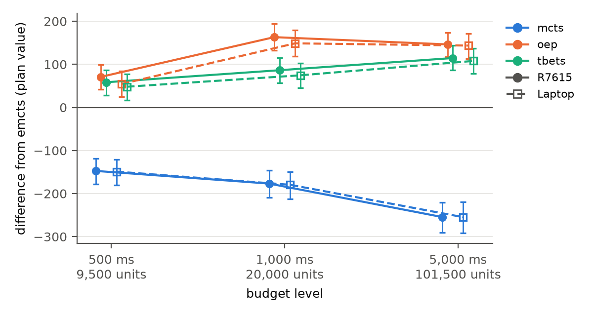
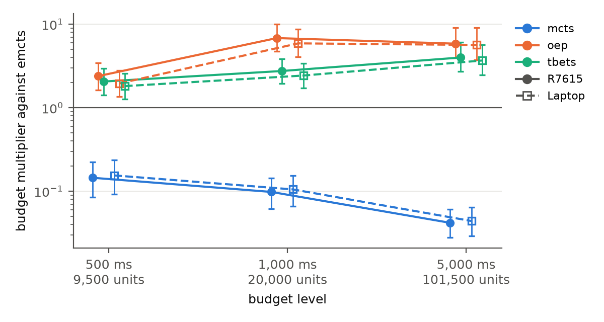
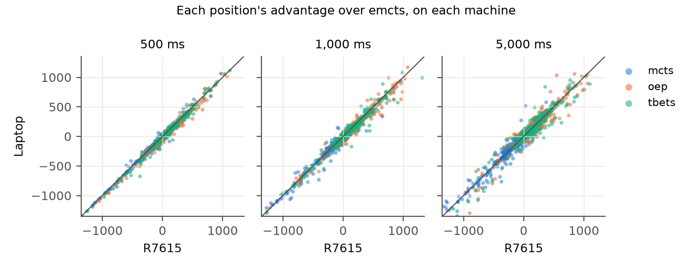
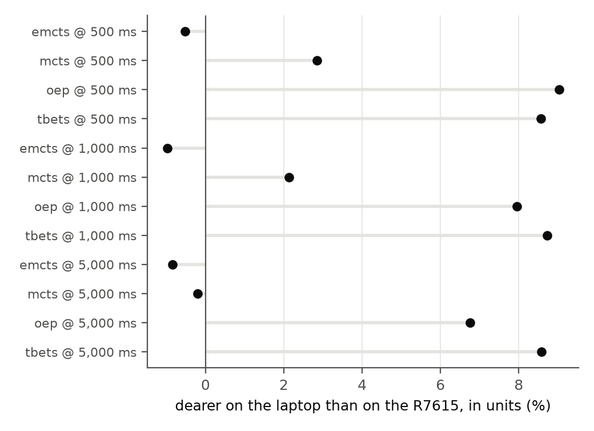

# The paper's tables and figures

Every table and figure here is built from the artefacts this repository publishes, and from nothing
else, by one command:

```bash
python magat.py paper
```

`python magat.py paper --check` builds them again in a temporary folder and fails unless every table
equals the committed one byte for byte. CI runs it on every pull request. Figures are rendered but not
compared, since their bytes depend on the plotting library's version and fonts; the numbers they plot
are the tables'. The script is [`tools/make_paper.py`](../tools/make_paper.py).

**Where the numbers come from:**
- The reference experiment as each machine played it: its run tree
  (`games/tribes/results/reference/<machine>/all/`) and its analysis (`.../report/tables/`). That is
  4 algorithms and the random floor, at 3 levels, on 400 positions, with 8, 8 and 6 repetitions. The
  machines are the R7615, the reference machine (`r7615`), and a laptop (`laptop-i9-14900hx`), each in
  its own currency.
- The comparison of the two (`games/tribes/results/reference/r7615-vs-laptop-i9-14900hx/`).
- Both currencies (`games/tribes/calibration/r7615-time/`, `.../laptop-i9-14900hx-time/`).
- The published levels (`games/tribes/levels.json`).

[`docs/results/cross-machine.md`](../docs/results/cross-machine.md) discusses these results.

## Tables

Each table comes as `.csv` (the numbers), `.md` (for reading) and `.tex` (a booktabs tabular), in
[`tables/`](tables/).

| Table | What it shows |
|---|---|
| [`levels`](tables/levels.md) | The budget levels: the units that are 500, 1000 and 5000 ms of thinking on the reference machine. |
| [`results`](tables/results.md) | Each algorithm against `emcts`, on each machine and at each level. It gives the paired difference in plan value, on the pairs where neither plan ends the game, and the budget multiplier: how much more budget `emcts` would need to match the algorithm. Both have scenario-clustered bootstrap 95% intervals. † marks a multiplier extrapolated above `emcts`'s highest level, which is a lower bound; ‡ marks one below its lowest. |
| [`agreement`](tables/agreement.md) | The two machines, position by position. It gives the share of turns identical on both; across positions, the correlation of each algorithm's advantage over `emcts` and the share with the same sign; and the share of positions on which both name the same best algorithm. |
| [`prices`](tables/prices.md) | What each algorithm's work costs in each machine's own unit: its operation mix at that machine's measured prices. A positive shift is work the laptop finds dearer than the R7615 does. |
| [`spend`](tables/spend.md) | How each algorithm spends its budget: the share of a turn's units, initialization included, paid for its own operations rather than the forward model's; the units spent as a share of the budget; and the length of its plan. |

## Figures

Each figure comes as `.pdf` (for the paper) and `.png` (below), in [`figures/`](figures/). Colour is
the algorithm; the machine is the marker: filled circles and solid lines are the R7615, open squares
and dashed lines the laptop.

**The paired difference from `emcts`, by level, on both machines** (`difference_by_level`). It plots
the plan value on the pairs where neither plan ends the game, with 95% intervals. `random` is in the
`results` table; at about −600 it would flatten the rest.



**The budget multiplier against `emcts`, by level, on both machines** (`multiplier_by_level`), on a
log scale, with 95% intervals. `mcts`'s multipliers fall below `emcts`'s lowest level, so they are
extrapolated downward. `oep`'s at 1000 and 5000 ms, and `tbets`'s at 5000 ms, are extrapolated
upward: lower bounds.



**Each position's advantage over `emcts`, R7615 against laptop** (`per_position`). Each point is one
position: the mean over its repetitions of the algorithm's plan value minus `emcts`'s, on the pairs
where neither plan ends the game. Points on the diagonal agree exactly. The `agreement` table's
correlations are taken over these points.



**How much dearer each algorithm's work is on the laptop than on the R7615, in each machine's own
unit** (`price_shift`). The unit is one forward-model advance of `emcts` at 500 ms on each machine, so
`emcts` sits near zero by construction. This shift is why the same budget buys the laptop slightly
less `oep` and `tbets` search, and why some turns differ between the machines.


